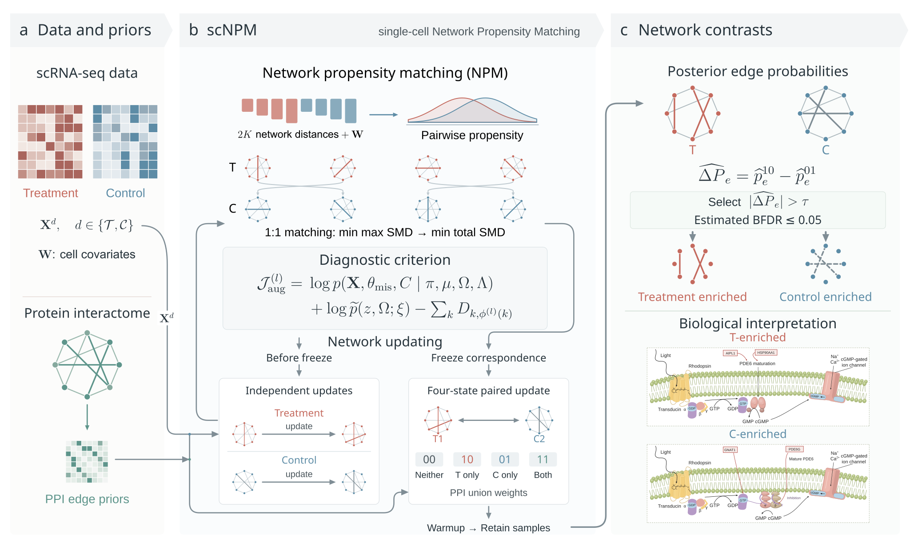

# scNPM: Single-Cell Network Propensity Matching

## Method overview



scNPM combines single-cell expression, measured cell covariates and protein
association information to estimate networks and compare corresponding cell
populations across two conditions.

1. **Estimate and match.** A latent Gaussian mixture represents heterogeneous
   expression and an observation model accounts for zeros. Distances to the
   same network references and measured covariates enter pairwise propensity
   models. One-to-one matching first minimizes the largest standardized mean
   difference (SMD), then the total SMD. Networks have independent priors during
   this adaptation stage.
2. **Freeze and jointly estimate.** Once correspondence is frozen, each matched
   pair uses four edge states: absent in both, treatment only, control only,
   and present in both. The public-PPI `union` rule supports all three
   edge-present states equally. Post-freeze warmup precedes retained sampling.
3. **Report networks and contrasts.** Posterior state probabilities give
   within-condition edge probabilities and treatment/control enrichment.
   Bayesian false discovery rate (BFDR) selection produces the reported edges;
   the output includes matching, balance, sampling and diagnostic summaries.

The workflow figure is supplied as [an SVG](inst/figures/scNPM_workflow.svg).
Its retinal pathway panels illustrate the biological interpretation step.

**Examples:** [Simulation](#manuscript-simulation) ;
[Public retinal data](#example-matched-retinal-networks) ;
[Data sources and reuse](inst/extdata/DATA_SOURCES.md)

## Installation

### Install directly from GitHub

```r
if (!requireNamespace("remotes", quietly = TRUE)) {
  install.packages("remotes")
}
remotes::install_github("taostat1/scNPM_R_package", upgrade = "never")
library(scNPM)
packageVersion("scNPM")
```

This installs the current default branch. To reproduce a particular analysis,
replace the repository argument with `"taostat1/scNPM_R_package@<commit-sha>"`,
using the full commit identifier for that analysis.

### Download the source and install locally

Download the [GitHub source ZIP](https://github.com/taostat1/scNPM_R_package/archive/refs/heads/main.zip),
or use **Code > Download ZIP** on the
[repository page](https://github.com/taostat1/scNPM_R_package).
Unzip it, then install the extracted package directory:

```r
remotes::install_local("path/to/scNPM_R_package-main", upgrade = "never")
```

The GitHub ZIP contains the R package source code.
For a separately supplied package archive, use:

```r
# Built source archive
install.packages("scNPM_1.1.1.tar.gz", repos = NULL, type = "source")

# Windows binary archive, if supplied for your R version
# install.packages("scNPM_1.1.1.zip", repos = NULL, type = "win.binary")
```

Source installation requires R >= 4.0 and a compatible C++17 toolchain;
on Windows, use the Rtools release matching your R version.
`remotes` installs missing R dependencies. For local archives installed with
`repos = NULL`, install their dependencies first (listed in DESCRIPTION).
Restart R before replacing a loaded installation.

## Manuscript simulation

[The manuscript simulation code](inst/paper_simulation/README.md) includes the
actual data generator, 3000/1500 cells per condition, ten replicates, eight
methods, network and differential-network metrics, and summary tables.
Dependencies, random seeds, tuning settings and output files are documented
alongside the scripts.

From a downloaded copy of this repository, run:

```sh
Rscript inst/paper_simulation/install_dependencies.R
Rscript inst/paper_simulation/run.R --phase prepare --n both --output paper_simulation_output
Rscript inst/paper_simulation/run.R --phase run --n both --threads 8 --output paper_simulation_output
```

Install scNPM first and configure AJGM's Python environment as described in the
[simulation instructions](inst/paper_simulation/README.md#dependencies).
The [reference results](inst/paper_simulation/reference_results) contain the
per-replicate manuscript metrics. To regenerate their summaries:

```sh
Rscript inst/paper_simulation/run.R --phase reference --output paper_reference_summary
```

## Example: matched retinal networks

The package includes a demonstration subset of **50 genes and 400 cells**:
200 peripheral (control) and 200 macular (treatment) retinal cells. This example
compares macular and peripheral regions in normal human retinas and illustrates the workflow.


**Data source:** [GEO GSE137537](https://www.ncbi.nlm.nih.gov/geo/query/acc.cgi?acc=GSE137537),
Menon et al. (2019), *Nature Communications* 10:4902,
[doi:10.1038/s41467-019-12780-8](https://doi.org/10.1038/s41467-019-12780-8).
The original study profiled normal human retinas. Credit the original authors
and accession when using the example. Public data and third-party resources
retain their source terms; see the
[full attribution, processing and reuse record](inst/extdata/DATA_SOURCES.md).
The STRING reference uses [CC BY 4.0](https://creativecommons.org/licenses/by/4.0/).

The subset is already installed with the package. It is also available as
[compressed counts](inst/extdata/retina_GSE137537/counts.csv.gz),
[cell metadata](inst/extdata/retina_GSE137537/cells.csv) and
[a gene list](inst/extdata/retina_GSE137537/genes.csv).
These files preserve the packaged data and require no GEO download to run.

The complete script is [inst/examples/amd_workflow.R](inst/examples/amd_workflow.R).
After installation, run it in a fresh R session with:

```r
Sys.setenv(OMP_NUM_THREADS = "2")
source(system.file("examples", "amd_workflow.R", package = "scNPM"))
```

### 1. Prepare expression, covariates and protein interactions

```r
library(scNPM)
data("top50_goal_gene_mt", package = "scNPM")
expression <- as.matrix(goal_gene_mt)
stopifnot(identical(as.character(cell$Barcode), colnames(expression)))
stopifnot(all(cell$PR_or_MR %in% c("No", "Yes")))

qc_names <- c(
  "scater_qc.all.total_features_by_counts",
  "scater_qc.all.total_counts",
  "scater_qc.endogenous.pct_counts",
  "scater_qc.feature_control_MT.pct_counts",
  "scater_qc.all.pct_counts_in_top_50_features"
)
cell_t <- cbind(
  treatment = as.integer(cell$PR_or_MR == "Yes"),
  as.matrix(cell[, qc_names, drop = FALSE])
)
colnames(cell_t) <- c("treatment", "detected_genes", "total_counts",
                      "endogenous_pct", "mitochondrial_pct", "top50_pct")
stopifnot(nrow(cell_t) == ncol(expression), all(is.finite(cell_t)))
ppi <- system.file("extdata", "top50_string_interactions_short.tsv",
                   package = "scNPM")
stopifnot(nzchar(ppi))
```

`cell_t` has one row per cell, in exactly the expression-column order. Its first
column is the 0/1 group indicator; the other five columns are measured QC
covariates. Supply these columns on their original scale: the propensity step
standardizes them within each pair-specific training fold. The eight
network-reference covariates for K = 4 are computed internally.

The PPI file supplies gene pairs and `combined_score`. In this implementation,
a positive score marks a supplied interaction; score magnitudes are not used
as continuous prior weights. Gene names must match the expression row names.
Use `protein_input = NULL` to use the common low baseline prior for all pairs.

### 2. Fit four clusters per condition

```r
fit <- run_scNPM(
  goal_gene_mt = expression, cell_t = cell_t, protein_input = ppi, K = 4,
  network_prior = "paired", ppi_reference = "union", # public STRING PPI
  num_iter = 5000, num_save = 1000,
  inference_mode = "staged", adapt_min = 100, adapt_max = 3000,
  freeze_patience = 5, final_burnin = 1000,
  matching_score = "pairwise", freeze_policy = "consensus", freeze_window = 100,
  network_covariates = "all_reference", matching_method = "lexicographic",
  differential_method = "bayes_fdr", fdr_level = 0.05,
  fdr_scope = "frozen", fdr_rule = "delta_threshold",
  group_fdr_level = 0.05, diagnostic_every = 10, ds_seed = 123,
  verbose = TRUE, progress_every = 60, progress_file = "scNPM_progress.csv"
)
```

The example retains iterations 4001--5000. Matching freezes no later than
iteration 3000, leaving at least 1000 final-model warmup sweeps. Five consecutive
identical complete maps allow an earlier stable freeze. At the adaptation cap,
the default uses the most frequent recent valid map and
continues warmup and sampling. Inspect `fit$sampling_schedule$freeze_reason`
(`stable` or `budget_consensus`) and `matching_stable` for the freezing rule
and matching stability. The run stops if no valid complete map is available,
the input is invalid, or a numerical error occurs.
Use `freeze_policy = "error"` for the original strict stability requirement.

`matching_score = "pairwise"` fits a balanced, five-fold ridge propensity
regression for every candidate cluster pair using the **known** condition
labels. It retains the shared network references, scalar score SMD, and
one-to-one maximum-SMD-then-total-SMD assignment. Each pair has a distinct
conditional score. Network features are estimated from the current full state,
and the score regression is cross-fitted. `matching_score = "global"` retains the
previous pooled score, and can be combined with `network_covariates = "legacy"`
and `matching_method = "greedy"` when reproducing older workflows.

With `verbose = TRUE`, progress is reported every 60 seconds and at stage
changes, including iteration, percentage, elapsed time, approximate ETA,
freeze reason and retained draws. Reports occur between completed sweeps.
`progress_file` appends CSV records even with `verbose = FALSE`; omit it to
avoid writing a file. Console messages remain suppressible with
`suppressMessages()`. Use different CSV paths for concurrent fits.

### 3. Inspect matching and differential selection

```r
fit$matching_result_df                 # Reported cluster pairs
fit$smd_results                        # Final-state score SMDs
fit$matching_objective                 # Maximum and total SMD for that map
fit$sampling_schedule                 # Freeze and retained-sample schedule
fit$group_fdr$summary                  # Separate BFDR for each group network
fit$differential_fdr$status
fit$differential_fdr$threshold         # Strict |delta_p| > threshold
fit$differential_fdr$estimated_error_bound
head(fit$differential_fdr$selected)
compute_qf_smd(fit)                    # Each network feature, by matched pair
fit$smd_covariate_results              # QC and network-feature balance
```

A row of `differential_fdr$selected` is one unordered gene pair in one matched
cluster comparison. `direction = "treatment"` or `"control"` names the enriched
condition. `delta_p` is
`p_treatment_only - p_control_only`; `error_bound` is the estimated error used
in selection. The mean error across the selected set is required to be at
most 0.05. An empty selection is returned with a mean error of zero.

### 4. Export tables, diagnostics and network plots

```r
out_dir <- "scNPM_example_output"
dir.create(out_dir, recursive = TRUE, showWarnings = FALSE)
write_csv <- function(x, name, row_names = FALSE) {
  write.csv(x, file.path(out_dir, name), row.names = row_names)
}
saveRDS(fit, file.path(out_dir, "fit.rds"))
write_csv(fit$matching_result_df, "matching.csv")
write_csv(compute_qf_smd(fit), "network_feature_smd.csv")
write_csv(fit$smd_covariate_results, "qc_covariate_smd.csv", row_names = TRUE)
write_csv(fit$group_fdr$summary, "group_bfdr_summary.csv")
write_csv(fit$group_fdr$table, "group_all.csv")
write_csv(fit$group_fdr$selected, "group_selected.csv")
set.seed(123)
for (network_name in names(fit$group_fdr$networks)) {
  net <- fit$group_fdr$networks[[network_name]]
  write_csv(net$mask, paste0("group_", network_name, "_mask.csv"), row_names = TRUE)
  if (!any(net$mask)) next
  p <- plot_group_network(net)
  if (!is.null(p)) ggplot2::ggsave(
    file.path(out_dir, paste0("group_", network_name, ".pdf")),
    plot = p, width = 7, height = 5
  )
}
write_csv(fit$differential_fdr$table, "differential_all.csv")
write_csv(fit$differential_fdr$selected, "differential_selected.csv")
write_csv(fit$differential_fdr$threshold_curve, "bfdr_threshold_curve.csv")
write_csv(fit$stage_history, "stage_history.csv")
write_csv(data.frame(iteration = seq_len(nrow(fit$matching_history)),
                     fit$matching_history), "matching_history.csv")
write_csv(fit$criterion_trace, "criterion_trace.csv")

maps <- fit$matching_history
mapping_changes <- if (nrow(maps) < 2L) 0L else
  sum(rowSums(maps[-1, , drop = FALSE] !=
                maps[-nrow(maps), , drop = FALSE]) > 0)
write_csv(data.frame(
  runtime_minutes = as.numeric(fit$runtime, units = "mins"),
  frozen_at = fit$sampling_schedule$frozen_at,
  adaptation_iterations = sum(fit$stage_history$stage == "adaptation"),
  mapping_changes = mapping_changes,
  retained_draws = fit$sampling_schedule$retained_draws,
  cutoff = fit$differential_fdr$threshold,
  selected_edges = nrow(fit$differential_fdr$selected),
  estimated_BFDR = fit$differential_fdr$estimated_error_bound,
  selection_status = fit$differential_fdr$status
), "run_summary.csv")

trace <- fit$criterion_trace
if (sum(is.finite(trace$J_aug)) >= 2L) {
  pdf(file.path(out_dir, "criterion_trace.pdf"), width = 7, height = 4)
  plot(trace$iteration, trace$J_aug, type = "l",
       xlab = "Iteration", ylab = "Diagnostic criterion")
  abline(v = fit$sampling_schedule$frozen_at, lty = 2, col = "grey50")
  dev.off()
}
set.seed(123)  # Reproducible plotting layouts
for (pair_name in names(fit$edge_diff_networks)) {
  net <- fit$edge_diff_networks[[pair_name]]
  if (net$solid_network$count + net$dashed_network$count == 0L) next
  p <- plot_diff_network(net$diff_matrix, fit$gene_names,
                         output_mode = "combined")
  if (!is.null(p)) ggplot2::ggsave(
    file.path(out_dir, paste0("differential_", pair_name, ".pdf")),
    plot = p, width = 7, height = 5
  )
}
writeLines(capture.output(sessionInfo()), file.path(out_dir, "sessionInfo.txt"))
```

For each matched pair, the script saves a combined differential network PDF
when selected edges exist. Solid edges denote treatment enrichment and dashed
edges denote control enrichment. The original `diff_matrix` carries the BFDR
selection masks; passing it directly preserves the selected set.

Group-network plots use their saved BFDR masks:

```r
plot_group_network(fit$group_fdr$networks$treatment_1)
plot_group_network(fit$group_fdr$networks$control_1)
fit$group_fdr$summary
```

For each condition and subtype, the selection ranks the marginal Rao-Blackwell
slab probabilities and retains the largest complete tie-block prefix whose
mean `1 - probability` is at most `group_fdr_level` (default 0.05). Inclusion
uses `probability >= cutoff`. Each of the eight networks for K = 4 has its own
BFDR calculation. Selection takes place on the full panel; use the saved mask
when extracting subnetworks or calculating gene-panel sensitivity.

`edge_treat_est` and `edge_ctrl_est` remain empirical allocation-frequency
arrays for compatibility. BFDR plots use the saved selection masks. A raw matrix passed
to `plot_group_network()` without a saved mask raises an error.
The former descriptive plot remains available explicitly:

```r
plot_group_network(fit$edge_treat_est[, , 1], fit$gene_names,
                   selection = "frequency", frequency_threshold = 0.5)
```

Existing staged 1.0.5 results that contain `joint_edge_probabilities` can be
updated without resampling:

```r
# fit <- readRDS("previous_fit.rds")
fit$group_fdr <- select_group_edges(fit, fdr_level = 0.05)
plot_group_network(fit$group_fdr$networks$treatment_1)
```

The selector reconstructs the marginal means using `p10 + p11` for treatment
and `p01 + p11` for control, and checks consistency across counterparts.

### Files written by the example

| File in `scNPM_example_output/` | Contents |
| --- | --- |
| `fit.rds` | Complete result, including selection attributes and provenance; reload with `readRDS()`. |
| `matching.csv` | One-to-one cluster correspondence and final-state SMD. |
| `network_feature_smd.csv`, `qc_covariate_smd.csv` | Network-feature balance and the combined QC/network covariate balance matrix. |
| `group_bfdr_summary.csv`, `group_selected.csv`, `group_all.csv` | Per-network cutoffs and BFDR, selected edges and the full marginal edge table. |
| `group_treatment_*.pdf`, `group_control_*.pdf` | BFDR-selected group networks, when nonempty. |
| `group_treatment_*_mask.csv`, `group_control_*_mask.csv` | Saved symmetric selection masks, including empty networks. |
| `differential_all.csv` | All tested gene-pair/cluster items, their probabilities, contrasts, errors and selection flags. |
| `differential_selected.csv` | Only selected differential associations. |
| `bfdr_threshold_curve.csv` | Candidate cutoffs, edge counts, mean errors and the chosen cutoff. |
| `run_summary.csv` | Runtime, freeze iteration, adaptation count, mapping changes, selected cutoff and estimated BFDR. |
| `stage_history.csv`, `matching_history.csv`, `criterion_trace.csv` | Iteration-level stages and matching, plus recorded criterion components. |
| `criterion_trace.pdf` | Diagnostic criterion against iteration. |
| `differential_treat_*_ctrl_*.pdf` | Selected differential network for each nonempty matched comparison. |
| `sessionInfo.txt` | R session and dependency versions. |

The function returns a list in memory; these files are written by the example
script. See the field reference below for parameter and network summaries.

## Informational output

`run_scNPM()` is quiet by default (`verbose = FALSE`). Use `verbose = TRUE`
for initialization, sampler progress and elapsed-time messages. All of these,
including C++ progress, use R message conditions and can also be suppressed
with `suppressMessages()`. Warnings and errors retain their normal behavior.
Runtime, dimensions, stages and diagnostic values are returned in the result.

## The default staged algorithm

1. Update latent expression, mixture and network states; recompute NPM without counterpart edge feedback.
   Align component labels to fixed initial mean anchors. The NPM matching is a
   complete assignment minimizing maximum cluster propensity-score SMD, then total SMD.
   Exact ties use a fixed traversal; no SMD cap is applied.
2. Freeze a complete bijection after `freeze_patience` consecutive identical
   assignments, no earlier than `adapt_min`. Every cluster must be nonempty at
   these checks. At `adapt_max`, `freeze_policy = "consensus"` selects the most
   frequent complete map in the last `freeze_window` valid states. Ties use
   maximum cost, then total cost, on the window's average cost matrix, followed
   by lexicographic map order. `freeze_policy = "error"` requests the previous
   strict rule. The schedule records which freezing rule was used.
3. From the next iteration, activate the
   selected final network prior. The default jointly samples four edge states
   for matched pairs. Finish at least `final_burnin` iterations before retaining
   the last `num_save` draws. Matched components are relabeled together so their
   partners and the frozen mapping are preserved.
4. Select group edges separately for each condition/subtype using marginal
   posterior errors. Select directional differential edges from final-stage joint edge-state
   probabilities, across all K clusters as one family.

The default final target uses a four-state paired network prior. The matching
determines which networks share this prior. Set `network_prior = "independent"`
to retain the 1.0.8 final network model. Switching network priors requires
a new sampling run.

The observation model is unchanged: positive values fix latent expression at
log X; zero values have sampled latent expression. HMC uses fixed step sizes,
fixed leapfrog counts and Metropolis acceptance correction.

## Network propensity covariates

For every cell in either condition, the default uses centered distances to all
2K current reference networks, ordered T1,...,TK,C1,...,CK:

Each covariate is a squared Mahalanobis distance: the cell's latent expression
is centered at the reference cluster mean, then weighted by that network's
precision matrix. Both conditions use the same reference networks, so their
features are directly comparable.

K = 4 therefore uses eight network covariates. These and the optional QC
covariates enter the logistic propensity model. With the default pairwise
scores, each candidate cluster pair has a separate regression. Predictor
scaling is learned in each training fold, the two conditions have equal total
weight, and the slope penalty is 0.001 times the total observation weight.
With `matching_score = "global"`, predictors use pooled scaling and
`propensity_ridge = 1e-6` stabilizes the pooled IRLS fit. Constant columns become
zero. `network_covariates = "legacy"` requests the original assigned-network,
uncentered quadratic form and requires global scores. Inspect both
propensity-score and feature SMDs.

## Inputs and a staged analysis

`goal_gene_mt` is a finite, nonnegative gene-by-cell matrix on the original
expression scale, with unique gene names. Rows of `cell_t` follow the cell
columns: its first column codes control 0 and treatment 1; remaining numeric
columns are covariates. `protein_input` accepts a data frame, TSV text or a
local TSV file with node1, node2 and combined_score, or NULL.

The complete retinal example above constructs these inputs and runs the staged analysis.


Budgets satisfy `adapt_min <= adapt_max` and
`adapt_max + final_burnin <= num_iter - num_save`. Earlier freezing gives a
longer actual final burn-in while keeping the retained window fixed. Defaults
resolve from this available pre-retention budget; see `?run_scNPM`. Assess MCMC
convergence using multiple chains and the retained diagnostic traces.

## Differential edges and error interpretation

For a treatment cluster k and an unordered gene pair, a treatment-direction
claim means slab allocation in k and spike allocation in its control
counterpart. A control-direction claim means the reverse. These states refer
to the small- and large-scale components of the continuous spike-and-slab prior.

The package averages joint four-state conditional probabilities for frozen
pairs. For other counterparts it averages within-draw products of conditional
marginals under the same frozen-pair model. The independent option uses
within-draw products for every pair. All-counterpart sensitivity uses the same
fitted paired model. The more supported direction under the frozen pairing
supplies the reported direction.

- `fdr_scope = "frozen"` (default): use errors for the frozen counterpart.
- `fdr_scope = "all_matchings"`: sensitivity analysis using the largest error
  over all K control counterparts for the chosen direction.

The default `fdr_rule = "delta_threshold"` computes `delta_p = p10 - p01`,
then scans every distinct strict cutoff `abs(delta_p) > tau`. Equal contrasts
are never split. For each whole threshold set, average its directional errors
`1 - max(p10,p01)` (or the all-counterpart bound). Choose the set with the most
edges among those whose average is at most `fdr_level`. These averages need not
be monotone in contrast order; the scan does not stop at the first failure.

`fit$differential_fdr$threshold` records tau; `threshold_curve` records every
candidate's size and mean error. Infinity selects no edges. The cutoff is the
next excluded score, or zero if all nonzero scores are included; the operator
is strictly `>`. The plot uses selection masks and does not apply +/-0.5 again.
`fdr_rule = "posterior_error"` retains the error-sorted prefix from 1.0.4.
There is one direction per unordered edge and treatment cluster, with all K
clusters sharing one budget. Below `fdr_min_draws` (default 200), return the
exploratory curve but no threshold discoveries. The batch MCSE summarizes
Monte Carlo variability.

This is an estimated **posterior expected directional FDP**, conditional on the
selected final model and label convention.

```r
conditional <- select_differential_edges(fit, scope = "frozen")
conservative <- select_differential_edges(fit, scope = "all_matchings")
```

## Criterion diagnostics

`criterion_trace` records `log_augmented_likelihood`, `network_prior_kernel`,
`matching_loss` and their combination `J_aug = likelihood + prior - loss`.
The augmented likelihood includes sampled missing latent expression and
component labels. The prior column records the state-wise network factor. SMDs are
recomputed against the frozen map after the switch. Undefined SMDs produce NA
loss/criterion values. Changes in stages also change the prior factor.

This trace describes interactions between modules and records stochastic
variation across iterations. Global matching optimizes (maximum SMD, total SMD)
for the current cost matrix. Freezing preserves that map as costs change.

## Compatibility and outputs

Use `inference_mode = "coupled", differential_method = "frequency",
matching_method = "greedy"` for the
earlier matching workflow, with legacy edge feedback removed. Its +/-0.5 selections are descriptive.
Posterior error selection uses staged-mode results. Keep draws from different
models separate. K=4 specifies four clusters per condition.

The returned list contains the following commonly used results:

| Field | Contents |
| --- | --- |
| `K`, `G`, `N`, `gene_names` | Clusters per condition, gene count, cell count and gene order. |
| `runtime` | Sampler runtime as a `difftime` value in minutes; excludes later export and plotting. |
| `edge_treat_est`, `edge_ctrl_est` | G x G x K retained slab-allocation frequency arrays. |
| `mu_treat_est`, `mu_ctrl_est` | Retained component-mean summaries. |
| `invcov_treat_est`, `invcov_ctrl_est` | Retained precision-matrix summaries. |
| `theta_treat_est`, `theta_ctrl_est`, `theta_est` | Retained latent-expression summaries for cells. |
| `group_treat_est`, `group_ctrl_est`, `group_est` | Cell cluster assignments. |
| `matching_result_df`, `match_map`, `smd_results` | Reported correspondence and final-state propensity-score balance. |
| `smd_covariate_results`, `network_covariates` | Balance of all QC/network covariates and the network-reference values used in matching. |
| `edge_diff_networks` | One entry per matched pair, containing the contrast matrix, treatment/control edge lists and counts. |
| `provenance` | Version, seed, settings, timestamps, thread information and input fingerprints. |
| `Result` | Retained sampler output and trace summaries; not a copy of every state from every iteration. |

Staged inference and selection also return:

| Field | Contents |
| --- | --- |
| `sampling_schedule` | Freeze iteration, minimum/actual final burn-in and retained interval. |
| `stage_history` | Per-iteration phase and feedback status. |
| `matching_history` | Per-iteration map, fixed after freezing. |
| `criterion_trace` | Augmented criterion components at recorded iterations. |
| `joint_edge_probabilities` | p00, p10, p01, p11 for every cluster pair, empirical checks and batch means. |
| `group_fdr` | Marginal probabilities, per-network masks, summary, selected/all edge tables and threshold curves; NULL in coupled mode. |
| `differential_fdr` | Edge table, threshold, full threshold curve, selections, target, scope and status. |
| `smd_cost_matrix`, `frozen_smd_cost_matrix` | All pair costs at the final state and at the freezing iteration. |
| `matching_objective` | Final-state maximum/total SMD under the reported map; frozen flag. |

`edge_diff_networks` and `plot_diff_network()` use the selected differential
edges in Bayesian mode. Keep the `scNPM_selection` attribute on the returned
`diff_matrix`: the plotting function reads these masks directly. Plain matrices
without that attribute retain the descriptive +/-0.5 plotting behavior.
`match_map` and `matching_result_df` use the frozen map,
while SMDs refer to the final sampled state under that map. The main edge
summaries are retained allocation frequencies; the new joint probabilities
use Rao-Blackwellization. Raw draws remain in `Result`.

The baseline PPI inclusion weight is
`ppi_prior_low + (ppi_prior_high - ppi_prior_low) * protein_adjacency`, with
defaults 0.05 and 0.5. During adaptation and in independent-prior mode these
are inclusion weights. The paired prior uses their odds ratios as described
below. The positive-definite matrix constraint is part of the joint prior.


## Four-state matched-network prior in 1.1.1

```r
# These settings are also recorded in fit$paired_prior and fit$provenance.
# Add them to the run_scNPM call above:
# network_prior = "paired",
# paired_discordance = 0.75,
# shared_edge_correlation = 0.995,
# ppi_reference = "union"
```

After matching freezes, the prior jointly models each gene pair in the two
matched networks using four states:

| State | Edge interpretation | Effect on network coefficients |
| --- | --- | --- |
| `00` | Absent in both conditions | Shrinks both coefficients toward zero. |
| `10` | Present only in treatment | Allows a treatment coefficient while shrinking the control coefficient. |
| `01` | Present only in control | Allows a control coefficient while shrinking the treatment coefficient. |
| `11` | Present in both conditions | Allows both coefficients and encourages similar signed values. |

Edge absence corresponds to the small-scale Gaussian component; edge presence
corresponds to the large-scale component. The complete prior also requires
both precision matrices to be positive definite.

`ppi_prior_low` controls the baseline edge weight. `paired_discordance`
controls the relative weight of condition-specific states: values below one
favor shared presence or shared absence. `shared_edge_correlation` controls
coefficient sharing in the jointly present state; its default of 0.995
strongly favors similar signed coefficients.

The default `ppi_reference = "union"` uses public PPI to support edge presence
in either condition. It gives the same PPI multiplier to treatment-only,
control-only and jointly present states, then normalizes the state weights.
This preserves the relative weights of those three states. Gene pairs missing
from PPI retain their baseline weights and can still be inferred from expression.

Other PPI reference options support condition-specific information:

| `ppi_reference` | How PPI changes the state weights |
| --- | --- |
| `"union"` | Supports all three edge-present states equally. |
| `"control"` | Supports control-only and jointly present states. |
| `"treatment"` | Supports treatment-only and jointly present states. |
| `"both"` | Applies support separately to each condition, giving the jointly present state two PPI factors. |

The sampler updates a paired edge state together with its two network
coefficients, retaining the existing observation-model HMC. Posterior state
probabilities provide treatment-only and control-only probabilities for
directional differential selection. Each condition's overall edge probability
adds its condition-only probability to the jointly present probability.

BFDR levels and tie handling are unchanged. Matching freeze fixes cluster
correspondence; the subsequent sampling stage estimates the paired network
posterior.

For formulae, assumptions and the error-bound proof, read
[algorithm.md](inst/algorithm.md). This file is also installed in the
package directory. Development repository:
[taostat1/scNPM_R_package](https://github.com/taostat1/scNPM_R_package).
License: GPL >= 3.

